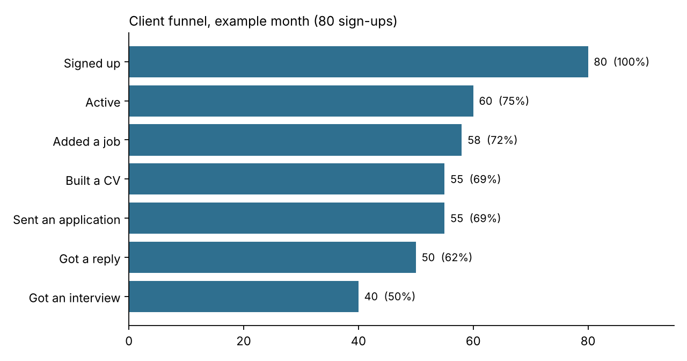
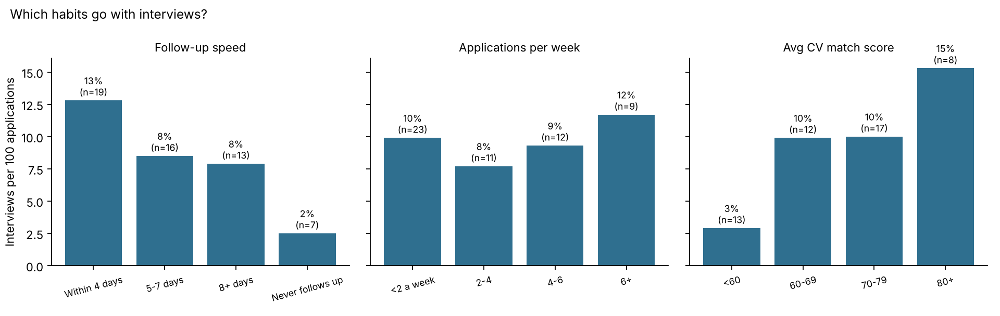
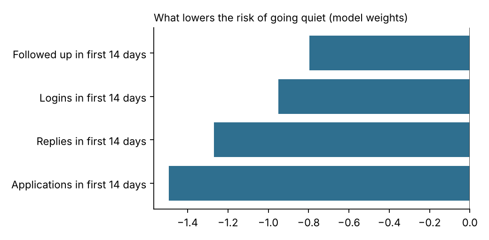
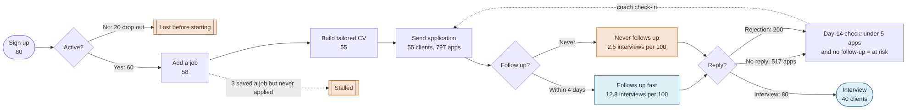

# What makes a client land interviews?

**Practice project with example data.** The brief comes from a career coaching business (Vanta). Every number in this repository is made-up example data, built to match the totals in the brief. None of it is real Vanta data.

## The question

Which job-search habits lead to interviews, and which clients are at risk of going quiet?

## The example month

| Stage | Clients | Volume |
|---|---|---|
| Signed up | 80 | |
| Active | 60 | |
| Added a job | 58 | 800 jobs |
| Built a tailored CV | 55 | 797 CVs |
| Sent an application | 55 | 797 applications |
| Got a reply | 50 | 280 replies (200 rejections + 80 interviews) |
| Got an interview | 40 | 80 interviews |

About 1 in 10 applications turned into an interview, and 65% of applications got no reply at all.



## What I found

**1. The biggest drop-off happens before anyone applies.** 20 of the 80 clients (25%) never became active, and another 5 were active but never sent an application. Together that is almost a third of sign-ups who never reached the first application.

**2. Follow-up speed is the strongest habit.**

| Follow-up habit | Clients | Interviews per 100 applications | Clients who got an interview |
|---|---|---|---|
| Within 4 days | 19 | 12.8 | 18 of 19 |
| 5 to 7 days | 16 | 8.5 | 13 of 16 |
| 8 or more days | 13 | 7.9 | 7 of 13 |
| Never follows up | 7 | 2.5 | 2 of 7 |

**3. CV quality matters more than volume.** Clients whose CVs scored 80+ against the job ad got 15.3 interviews per 100 applications, against 2.9 for clients scoring under 60. Sending more applications added more interviews, but the hit rate stayed at about 8 to 12 per 100 at every volume level. Spearman correlation with interview rate: CV match score 0.47, follow-up rate 0.28, applications per week 0.12.



**4. You can spot who will go quiet in the first two weeks.** 16 of the 60 active clients went quiet (no activity for 14+ days by the end of the month). A logistic regression trained only on first-14-day signals (applications, logins, follow-ups, replies) separated them well, with a cross-validated AUC of 0.94. That figure is high because this is clean example data, so expect less on real data. The useful part is the reasoning: early applications and early replies are the strongest protection.

A rule simple enough for a coach to use without a model: **fewer than 5 applications and no follow-up in the first 14 days**. It flags 22 clients and catches 15 of the 16 who went quiet, with 7 false alarms. A false alarm costs one check-in message, so that trade-off is acceptable.



## Three recommendations

1. **Get every client to a first application within 48 hours.** A third of sign-ups never sent one. Make onboarding end with one tailored CV sent, and nudge on day 3 if it hasn't happened.
2. **Make follow-up the default and bring it forward.** Prompt clients to follow up on day 4 with a ready-written note, instead of a later reminder. Fast followers got about five times the interview rate of clients who never followed up.
3. **Run a day-14 check-in for at-risk clients, and set a CV quality bar.** Flag anyone with fewer than 5 applications and no follow-up by day 14 for a coach message. Encourage a match score of 70+ before sending.

## Limits

- Example data, small sample (80 clients). Treat the patterns as hypotheses to test, not proof.
- These are correlations. Fast followers may also be more motivated in general. An A/B test of earlier follow-up reminders would show cause and effect.
- Five applicants have no CV match score and four active clients have no days-active value. They are left out of those specific cuts, not filled in.

## How it was built: the full business analysis toolkit

| Stage | Tool | File |
|---|---|---|
| Requirements | Confluence-style BRD | `docs/BRD.md` |
| Process mapping (as-is, with drop-off points) | Process map (Mermaid, can be redrawn in Visio or Lucidchart) | `docs/client_journey_process_map.png` |
| Backlog: 1 epic, 6 user stories with acceptance criteria, 2 sprints | Jira (CSV import) | `jira/backlog_jira_import.csv`, `jira/BACKLOG.md` |
| Example data, made messy on purpose | Python | `src/generate_data.py` → `data/raw/clients_raw.csv` |
| Cleaning, funnel, habits, at-risk model | Python (pandas, scikit-learn) | `notebooks/analysis.ipynb` |
| The same analysis in SQL | SQL (SQLite) | `sql/queries.sql` |
| Spreadsheet model with live formulas and charts | Excel (COUNTIFS, SUMIF, SUMPRODUCT) | `excel/client_interview_analysis.xlsx` |
| Dashboard | Power BI and Tableau | `powerbi/PowerBI_build_guide.md` |
| Presentation to the stakeholder | Slides | Presented to Dylan |



Run it:

```
pip install pandas numpy scikit-learn matplotlib
python src/generate_data.py
python src/analysis.py
```
